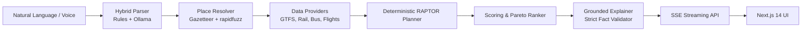

# Zero-Friction Transit Orchestrator

> **Reimagine Everyday Life: Make the Complex Simple**  
> One natural-language sentence produces ranked, unified multi-modal itineraries across India (train, bus, flight, plus transfers) with layovers, total cost, and honest data-quality labels.

---

## 1. Problem & Solution

### The Everyday Problem
Planning intercity or regional travel in India currently requires navigating fragmented silos:
- Railway booking portals (waitlists, Sleeper vs. 3AC quotas, tatkal uncertainties).
- Multiple private and state bus applications (APSRTC, KSRTC, TSRTC, private sleepers).
- Flight booking aggregators.
- Manually calculating layover safety, cross-town station transfers, arrival buffers, and aggregate travel budgets.

For university students heading home on weekends, interns, and occasional travelers, this creates high friction and cognitive overload.

### The Zero-Friction Solution
A user types or speaks a single sentence:
> *"Find me a combined train and bus route home for Friday evening under ₹800"*

The orchestrator produces a ranked, unified multi-leg itinerary with exact layovers, total elapsed time, NULL-safe pricing, and honest data-truth badges.

---

## 2. Core Features
- **Zero-Form Natural Language Search**: Text or voice input via Web Speech API.
- **Hybrid Intent Parsing**: Fast deterministic rules (dateparser, regex, rapidfuzz) with local LLM fallback (Ollama `qwen2.5:7b-instruct`) when confidence is low.
- **Interactive "Understood As" Chips**: Live editable chips (From, To, Date, Window, Budget, Class, Modes, Passengers).
- **RAPTOR Multi-Modal Routing**: Pure Python Round-Based Public Transit Routing supporting up to 3 legs by default.
- **Honest Data Truth Badges**: Every leg and fare is explicitly tagged (`OFFICIAL_TIMETABLE`, `COMMUNITY_GTFS`, `LIVE_API`, `ESTIMATED`, `USER_PROVIDED`, `UNKNOWN`).
- **NULL-Safe Pricing**: Fares with unknown leg costs display as `~₹450 est.` or `Fare unavailable`; never treated as ₹0 in budget filters.
- **Waitlist Confirmation Estimator**: Machine-learning logistic regression model with heuristic fallback labeled clearly as "estimate".
- **Smart Nudges**: Suggests earlier/later departures that yield confirmed seats or lower fares.
- **Comprehensive Auth & Profiles**: Argon2 password hashing, rotating refresh cookies, CSRF protection, saved trips, and custom places (Home, College).

---

## 3. Anti-Hallucination & Honest Data Guarantees

```
┌─────────────────────────────────────────────────────────────┐
│                    ANTI-HALLUCINATION RULES                 │
├─────────────────────────────────────────────────────────────┤
│ 1. The LLM NEVER generates train/bus/flight numbers,       │
│    timings, fares, availability, or routes.                │
│ 2. Code decides all facts; LLM is restricted to parsing     │
│    and rephrasing strictly grounded itinerary facts.        │
│ 3. Grounding validator rejects any text mismatching facts.  │
│ 4. No synthetic routes: missing data remains honest NULL.   │
└─────────────────────────────────────────────────────────────┘
```

---

## 4. Architecture



### Technology Stack Table
| Layer | Technologies |
| :--- | :--- |
| **Frontend** | Next.js 14 (App Router), TypeScript, Tailwind CSS, shadcn design tokens, Framer Motion, Lucide Icons, TanStack Query |
| **Backend** | Python 3.11+, FastAPI, Pydantic v2, SQLAlchemy 2, Alembic, SQLite (dev) / PostgreSQL (prod), slowapi, structlog |
| **Security** | Argon2id (`argon2-cffi`), JWT (15 min) + Rotating Refresh (7 days) in httpOnly SameSite=Lax cookies, CSRF Double-Submit |
| **Routing & ML** | Pure Python RAPTOR timetable algorithm, scikit-learn Logistic Regression for waitlist estimation |
| **Testing** | pytest, pytest-asyncio, hypothesis, freezegun, Vitest, React Testing Library, ESLint, Ruff, Mypy |

---

## 5. Quick Start (<= 5 Commands)

```bash
# 1. Clone repository
git clone https://github.com/example/zero-friction-transit.git && cd zero-friction-transit

# 2. Setup environment variables
cp .env.example .env

# 3. Pull recommended local LLM model (optional, basic mode works without LLM)
ollama pull qwen2.5:7b-instruct

# 4. Start all services via Docker Compose
docker compose up --build -d

# 5. Open your browser
# Frontend: http://localhost:3000 | Backend API Docs: http://localhost:8000/api/docs
```

### Local Manual Development Setup
```bash
# Backend
cd backend
python -m venv .venv
# Windows: .\.venv\Scripts\activate | Unix: source .venv/bin/activate
pip install -e ".[dev]"
uvicorn app.main:app --reload --port 8000

# Frontend
cd ../frontend
npm install
npm run dev
```

---

## 6. Testing & Quality Verification

Run the full automated test suites across both backend and frontend:

```bash
# Run backend pytest suite
cd backend && pytest -v

# Run backend linter and typechecker
cd backend && ruff check . && mypy app tests

# Run frontend Vitest suite
cd frontend && npm test

# Run frontend typechecker and linter
cd frontend && npm run typecheck && npm run lint
```

---

## 7. Data Sources & Licenses
For complete details on data sources, coverage tiers, and validation policies, see [docs/DATA_SOURCES.md](docs/DATA_SOURCES.md).

---

## 8. License & Acknowledgements
- **License**: MIT License (see [LICENSE](LICENSE)).
- **Attributions**:
  - Open Data community transit contributors.
  - Indian Railways timetable data models based on public tariff rules.
  - OpenStreetMap & Leaflet mapping infrastructure.
