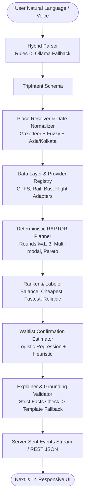

# Architecture Overview: Zero-Friction Transit Orchestrator

## 1. System Pipeline

## 2. Component Breakdown

### 2.1 Parser (Hybrid)
1. **Rule Engine**:
   - Dates & time windows: Parsed using `dateparser` relative to timezone `Asia/Kolkata`.
   - Budget parsing: Regex patterns matching `₹`, `Rs`, `rupees`, with comma formatting.
   - Mode & class constraints: Extracted via keyword tables (`AC`, `Sleeper`, `no buses`).
   - Place candidate extraction: Fuzzy matching via `rapidfuzz` against the local gazetteer (threshold 88).
2. **LLM Fallback (Ollama `qwen2.5:7b-instruct`)**:
   - Invoked ONLY when field-level confidence is low or key slots are missing.
   - Temperature = 0, constrained JSON schema output, 1 retry with exponential backoff.
   - Input sanitization: strips control characters, caps at 300 characters, rejects prompt injections.
   - Anti-hallucination guarantee: The LLM chooses ONLY from gazetteer candidates supplied in the prompt context.

### 2.2 Place Resolver & Date Normalizer
- Disambiguates duplicate station/city names (e.g., Aurangabad MH vs. Aurangabad BH).
- Handles multi-station city clusters (e.g., Hyderabad -> HYB, SC, KCG).
- Maps regional aliases in Hindi and Telugu.

### 2.3 Data Layer & Providers
- Common interface: `TransitProvider`.
- Truth levels recorded on every leg and fare:
  - `OFFICIAL_TIMETABLE`
  - `COMMUNITY_GTFS`
  - `LIVE_API`
  - `ESTIMATED`
  - `USER_PROVIDED`
  - `UNKNOWN`
- Freshness enforcement: Detects expired calendars and flags data validity.
- Offline-first development: Commits tiny high-fidelity fixtures in `data/fixtures/`.

### 2.4 Planner (Deterministic RAPTOR)
- Pure Python Round-Based Public Transit Routing (RAPTOR).
- Rounds $k \in \{1, 2, 3\}$ representing maximum legs/transfers.
- Enforces transfer edges, layover buffer times ($30 \le t \le 240$ min), domestic flight check-in buffers (90 min).
- Pareto multi-criteria optimization on `(arrival_time, known_cost, transfers_count, reliability_score)`.
- **NULL-Safe Pricing**: Fares with unknown leg costs are never treated as ₹0; budget filter correctly marks itineraries as "Budget unverified" instead of falsely matching.

### 2.5 Waitlist Confirmation Estimator
- Scikit-learn Logistic Regression trained on historical waitlist progression data.
- Input features: `(waitlist_position, class_code, days_until_departure, quota)`.
- Monotonic heuristic fallback if model artifact is absent. Labeled honestly as "Estimate".

### 2.6 Explainer & Grounding Validator
- Generates natural language summaries explaining "Why this route?".
- **Grounding Validator**: Regex & AST-based verification that every train number, stop name, time, price, and certainty statement in the text matches the deterministic itinerary payload.
- Any mismatch or exaggeration instantly discards LLM output and falls back to a deterministic template.

---

## 3. Anti-Hallucination Non-Negotiables
1. The LLM **NEVER** generates routes, timetables, train numbers, operators, or prices.
2. Code decides all facts; AI is strictly restricted to parsing ambiguities and summarizing verified facts.
3. If no route satisfies constraints: Returns "No matching route found in available data" with the exact failed constraint and one-tap relaxation suggestions.
